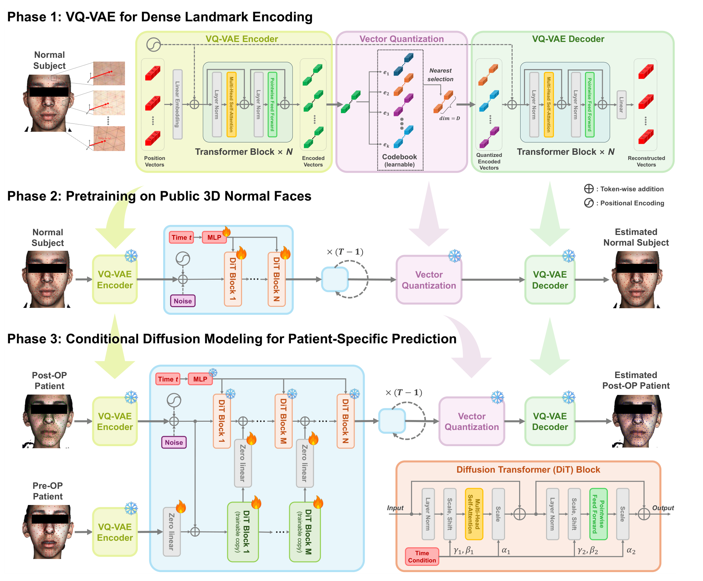
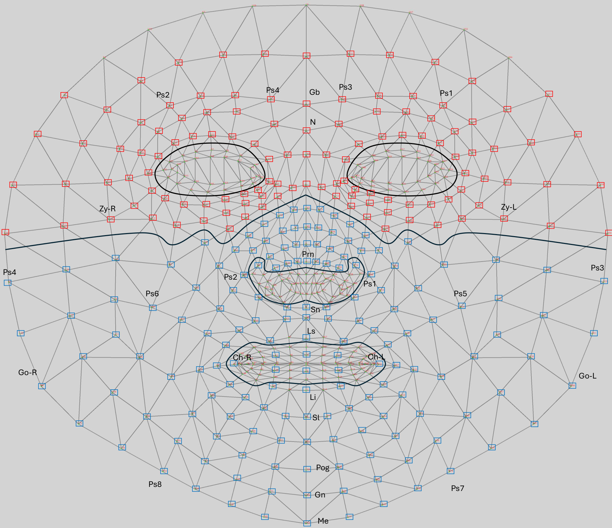

# FAPOS: Facial Appearance Prediction for Orthognathic Surgery

**Facial Appearance Prediction for Orthognathic Surgery with Diffusion Models**  
Jungwook Lee, Xuanang Xu, Daeseung Kim, Tianshu Kuang, Hannah H. Deng, Xinrui Song, Yasmine Soubra, Michael A.K. Liebschner, Jaime Gateno, Pingkun Yan  
*Medical Image Analysis* 109 (2026) 103934

---

## Overview
FAPOS is a deep learning framework for predicting a **patient-specific normal-looking 3D facial appearance** from the preoperative face, as the first step of **soft-tissue-driven orthognathic surgical planning**.  
It is a **transformer-based latent diffusion model** on a dense 282-landmark representation, pretrained on a large-scale dataset of 44,602 public 3D faces and fine-tuned on paired pre- and postoperative patient faces, and it does not need a bone plan.

---

## Key Features
- **Dense Landmark Representation**: 282 anatomically meaningful landmarks with point-to-point correspondence across subjects.
- **Large-scale Pretraining**: A generative prior of normal faces learned from diverse ages, sexes, and ethnic backgrounds.
- **Conditional Latent Diffusion**: Patient-specific prediction through a conditional path attached to a diffusion transformer.
- **3D Surface Reconstruction**: Outputs full 3D facial meshes for surgical planning.
  
---

## Method
1. **VQ-VAE** encodes the dense facial landmarks into a latent space (Phase 1).  
2. **Latent Diffusion Transformer (DiT)** learns an unconditional prior of normal faces from public datasets (Phase 2).  
3. **Conditional Fine-tuning** trains a copy of the DiT blocks connected through zero-initialized linear layers, first on facial expression pairs and then on patient pre- and postoperative pairs (Phase 3).  
4. **Thin-Plate Spline (TPS)** reconstructs the 3D surface.

---

## Landmark Index Set
The 282 landmarks are selected from the 478-point annotation scheme of [Google's MediaPipe](https://ai.google.dev/edge/mediapipe/solutions/vision/face_landmarker) and refined to focus on regions that are anatomically and clinically relevant to orthognathic surgery. Redundant or unrelated regions (e.g., periocular areas, eyebrows) are excluded. The landmarks are grouped into **upper midline**, **upper left / upper right**, **lower midline**, and **lower left / lower right** regions (upper face 119 points, lower face 163 points).

- [`fapos_landmark_indices.txt`](./fapos_landmark_indices.txt): Python-style dictionary lists of landmark indices grouped by region.
- [`Landmark_figure.pdf`](./Landmark_figure.pdf): anatomical regions and selected landmarks.



---

## Dataset
- **Pretraining**: DAD-3DHeads, Headspace, FaceScape, BU-3DFE (total 44,602 faces).
- **Fine-tuning**: 60 orthognathic surgery patients (in-house dataset).

Due to privacy concerns, patient data is not publicly released.

---

## Results
- **Chamfer Distance**: 1.86 mm (lips), 2.50 mm (chin), 2.04 mm (lower face); smallest error among compared methods in all five regions.
- Generates **realistic, patient-specific** postoperative predictions with improved facial symmetry and identity preservation.

---

## Installation
Tested with Python 3.9.

```bash
conda create -n fapos python=3.9 -y
conda activate fapos
pip install -r requirements.txt
```

On a headless Linux server (no display) replace the VTK wheel with the OSMesa build:
```bash
pip uninstall -y vtk
pip install --extra-index-url https://wheels.vtk.org vtk-osmesa==9.3.1
```

## Inference from your own STL
`run_fapos.py` takes a preoperative facial surface and writes the predicted postoperative surface.

**Input**: a facial soft-tissue surface in STL (CT segmentation or 3D photograph), in millimetres,
aligned in natural head position: the face looks toward **-y**, the top of the head points to **+z**, patient-left is **+x**.

```bash
python run_fapos.py \
  --stl   patient/Face.stl \
  --out   results/patient \
  --vqvae VQVAE_PATH \
  --fapos FAPOS_PATH
```

| option | meaning |
|---|---|
| `--seed N` | diffusion sampling is stochastic; the seed fixes the draw |
| `--fapos A.pt B.pt ...` | average the predictions of several checkpoints |
| `--crop` | also save the cropped facial region |
| `--device cuda:0` | run the networks on a GPU (default: CPU) |
| `--sparse-views` | 25 instead of 81 rendered views (faster) |

**Output** (in the coordinate frame of the input STL):

| file | content |
|---|---|
| `Face_predicted.stl` | predicted postoperative surface |
| `Face_landmarks478_pre.mrk.json` | dense landmarks detected on the input (3D Slicer markup) |
| `Face_landmarks282_pre.mrk.json`, `Face_landmarks282_predicted.mrk.json` | model input / predicted landmarks |
| `Face_fapos.json` | run settings |

Pipeline: 81 off-screen renderings of the mesh → MediaPipe FaceLandmarker (478 points) → back-projection onto the mesh
and multi-view merging → 282 landmarks → VQ-VAE latent → conditional latent diffusion (1,000 steps) → predicted landmarks →
TPS deformation of the input mesh. The normalization statistics are computed from the preoperative landmarks.

## Citation

```bibtex
@article{lee2026fapos,
  title   = {Facial appearance prediction for orthognathic surgery with diffusion models},
  author  = {Lee, Jungwook and Xu, Xuanang and Kim, Daeseung and Kuang, Tianshu and Deng, Hannah H. and Song, Xinrui and Soubra, Yasmine and Liebschner, Michael A.K. and Gateno, Jaime and Yan, Pingkun},
  journal = {Medical Image Analysis},
  volume  = {109},
  pages   = {103934},
  year    = {2026},
  doi     = {10.1016/j.media.2026.103934}
}
```

## License
The code written for FAPOS is under the MIT license. `model/` and `diffusion/` derive from [DiT](https://github.com/facebookresearch/DiT) and keep its CC BY-NC 4.0 license. See [`LICENSE`](./LICENSE).

## Acknowledgments
This work was supported by the National Institutes of Health (NIH) under awards R01DE027251 and R01DE021863.
The diffusion transformer builds on [facebookresearch/DiT](https://github.com/facebookresearch/DiT); landmark detection uses [MediaPipe](https://github.com/google-ai-edge/mediapipe).
